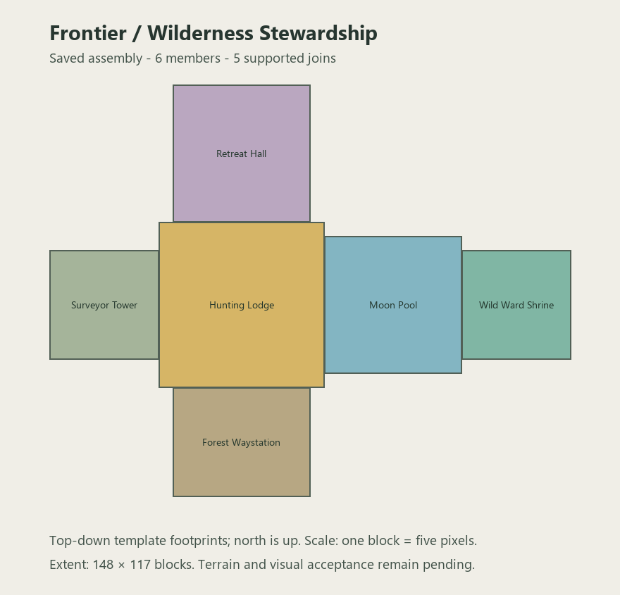

# Frontier / Wilderness stewardship

Implements all six archetypes in Ancient Elven Structure Roster §6.12 as one remote retreat complex. A Green Noble Hunting Lodge connects the Surveyor's Tower, Forest Waystation, Outlying Retreat Hall and Moon Pool Sanctuary; the sanctuary leads onward to a damaged Wild Ward Shrine.

The lodge's formal household has become a crowded refuge, with service-wing beds and a healer's remains. The waystation keeps an open timber shelter, abandoned traveler stores and a small burial plot. The retreat hall preserves a screened archive and a surviving irrigated food garden. The survey tower has a supported stair to the surviving instrument platform. The ward shrine has one broken marker and a repair camp that failed to restore the boundary. Two contained moon pools sit below the walking level beside abandoned keeper beds.

Paired moonstone and Source channels run alongside the circulation lane. Modular dreamwood ribs, glass apertures, long-lived paving, water containment and foundations express a managed elven landscape rather than six unrelated wilderness huts. Ruin volumes are explicit air; eight blocks of authored foundation support each module. No lamps are scattered across the precinct. Loot is limited to ordinary records, food, wool and seeds.

The generator writes 16 files: six templates, six pools, one assembly definition, one biome tag and two loot tables. All five joins use supported, level walking passages. The tower's upper platform is reachable through its surviving stair. Static checks cover source equality, registered blocks, non-overlap, circulation, foundations, furnishings, water containment and the garden. Runtime evidence is recorded separately in `tools/frontier_stewardship_runtime.json` and its saved-world census. Client visual and natural terrain-fit acceptance remain pending.

Saved-world validation confirms six members, five supported joins, 207,114 authored air cells and 67,056 foundation cells. The moon pools, garden, beds, remains, cultural modules and survey stair match the source. The original assembly is in `validation-frontier-stewardship-20261013`; validation resumed on 2026-10-14 against the current checkout. The separate void-detail test uses artificial hosts and does not establish natural frequency.

Natural spawning is not enabled for this family. Controlled review command in a disposable world:

`/execute in mythicbotany:alfheim run place structure alfheim:frontier_stewardship ~ ~ ~`

With this prototype, all twelve roster families have implementations. The next phase is reviewing representative terrain fit, visual quality and natural frequency, particularly for Sacred, Military/Warden and Frontier, before enabling their natural sets. The user's accepted approximate harbor policy remains in force.
