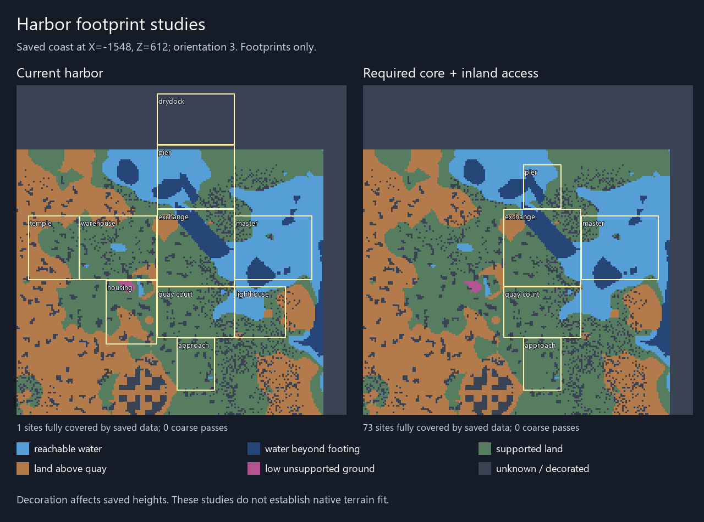
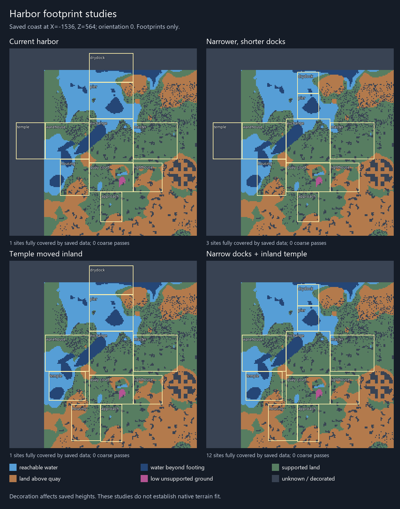

# Harbor footprint comparison - 2026-10-13

The narrower harbor is a measured development proposal, not a placed or admitted
structure. Four full socket-connected layouts were compared before rebuilding furniture
or replacing the existing furnished templates. All retain ten functional sections,
nine joins and non-overlapping footprints. Their hypothetical connection geometry
is derived from the same template dimensions and south-facing incoming sockets;
the baseline is checked against the actual shipping NBT layout.

| Arrangement | Bounding footprint | Saved preflight orientations | Fully covered by saved data | Coarse passes |
|---|---|---:|---:|---:|
| Current harbor | 172 x 180 | 207 | 1 | 0 |
| Narrower, shorter docks | 172 x 160 | 207 | 3 | 0 |
| Temple moved inland | 141 x 188 | 187 | 1 | 0 |
| Narrow docks and inland temple | 141 x 168 | 187 | 12 | 0 |
| Required core with inland access | 94 x 137 | 207 | 73 | 0 |

The dock proposal uses 23 x 27 and 23 x 23 footprints instead of 47 x 39 and
47 x 31. Moving the temple inland requires moving worker housing onto the approach
branch and extending that approach to 40 blocks to prevent overlap. These are
footprint studies; their furniture, decline layers and new NBT are not authored.
The existing shipping templates remain unchanged.

The fifth proposal follows the required/optional distinction in the authoritative
roster, section 7.6: exchange, seawall and harbormaster are required; drydock,
warehouses, lighthouse, temple and housing are optional satellites. It retains the
three required sections plus quay court and inland approach, connected by four
joins. The earlier complete ten-section footprint is a maximum assembly, rather
than the minimum harbor that every site must accommodate. The core remains a
footprint experiment; templates and safe closures at omitted branches still need
authoring before it can be placed.



The saved-world comparison measures 461,568 columns at four-block origin spacing.
Candidates require shallow dock water, dry exchange-center ground and a dry inland
approach. Every variant uses the same lowest-footing and upper-quay limits. Missing
columns are failures and fully covered candidates rank ahead of partial coverage.
Decorated heightmaps and inferred water identity cannot establish native fit.



Native comparison checks then tested all four layouts at five sites: (-1536,564),
(-1528,616), (-1552,544), (704,544) and (720,544). Three sites have eligible shore
biomes. None of the twenty checks passed the complete footprint. All independently
checked sampled heights matched Minecraft's height methods. Rejection checks took
133-1530 ms; this is not successful-path generation cost.

The required-core proposal then received five separate native audits, including
its strongest saved-terrain candidate at (-1548,612). All five were rejected;
three are in eligible shore biomes. At Sporebank (704,544), it passed the coarse
phase and reached every-column checking, sampling 2,523 distinct columns before
rejection. That late rejection took 17,734 ms, exposing a performance gate as well
as a fit gate. Optimizing only early-rejection cases would miss this cost.
Native height-method parity passed; server and harness exited 0.
Evidence: `tools/harbor_core_native_validation.json` and
`server/console-20261013-105849.log`. No core template was placed.

The native profiles establish physical constraints beyond decoration. At
(-1528,616), a sampled land column at (-1512,616) has first-free height 75, above
the maximum permitted height 73. At (-1536,564), a sampled water column at
(-1536,580) has seabed first-free height 57, below the current footing reach of 58.
The narrowed dock at the Sporebank origin (704,544) samples water at (662,532)
with seabed first-free height 55. The narrower layout reaches later checks there
but still cannot bridge that unsupported depth. None of these sites was filled
or forced to accept a harbor.

The first-party companion now has a read-only operator diagnostic:

```text
execute in mythicbotany:alfheim run alfheimharbor audit_proposal narrow_docks_inland_temple <x> <z>
```

Other proposal names are `shipping`, `narrow_docks`, `inland_temple` and
`core_with_approach`. This command
does not place templates or enable natural generation. Default natural placement
and checked placement still use the original furnished footprint. The diagnostic
uses the same waterline, footing, relief and every-column policy as that footprint.
Generated Java proposal geometry is checked for source equality.

Java 17 build and twelve policy tests passed. New tests exercise all five proposals
in all coastal orientations, rejection of unknown proposal names and a narrow
single-column hazard inside the retained dock footprint. A hazard in a removed
dock area rejects the original footprint while leaving the compact proposal valid.
The core test also verifies the required membership and supported access sections,
allows a hazard confined to an omitted drydock, and still rejects an unsupported
column inside the retained core. Prior first-party jars are retained under
`quarantine/first-party-harbor-proposals-20261013/` and
`quarantine/first-party-harbor-core-proposal-20261013/`.

Evidence: `tools/harbor_adaptation_screen.json`,
`tools/harbor_proposal_native_validation.json`, and
`server/console-20261013-104933.log`. Server and validation harness exited 0.
All 39 protected broad terrain files remain unchanged; the 103-model geometry and
field-repair checks pass, and feature ordering has zero cycles. Player saves and
third-party jars were not edited.

Next implementation target: terrain-aware required-core placement with optional
satellites, safe closures of unused branches, and supported quay connections.
Where support or bank-height constraints remain, any footing extensions or stepped
quays must provide physical construction before a placement limit changes.
The 17.7-second late rejection also requires a native sampling/performance repair
and another measured late-path check before natural generation can be enabled.
Harbor remains the active target; complete native placement, cost and client visual
fit still precede natural admission.
