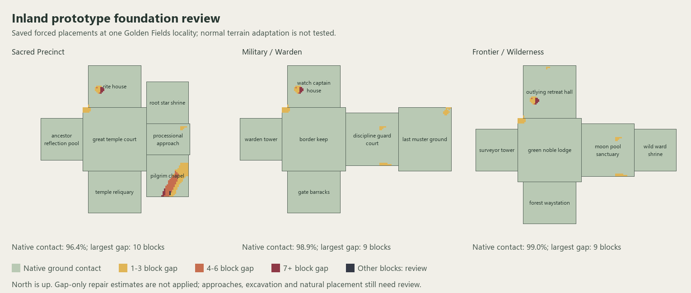

# Inland prototype terrain review

One shared Golden Fields locality, not biome-wide or natural-frequency acceptance. The reference uses current same-seed generation, not an exact historical snapshot; decoration can differ. Forced placement does not replay normal beard_thin terrain adaptation, which is not tested here. Measurements do not enable any natural structure set. Full lowest-layer foundation columns are checked; a gap value of 33 means no ground found within the 32-block search. Client review remains required.

| Family | Reference native contact | Saved native contact | Unsupported saved base columns | Largest saved gap | Reference ground replaced by room air |
|---|---:|---:|---:|---:|---:|
| sacred_precinct | 96.4% | 96.4% | 299 | 10 | 4557 |
| military_warden | 99.1% | 98.9% | 102 | 9 | 16126 |
| frontier_stewardship | 99.0% | 99.0% | 86 | 9 | 11859 |

Foundation depth alone does not prove terrain fit. Inspect the piece-level gaps, excavation, exterior grades and existing-structure warnings in `tools/inland_terrain_review.json` before changing placement policy. All three natural sets remain disabled. The reference world retains normal natural generation; the harness placed no review structures and edited no player saves.

## Repair targets and bounded alternatives

- sacred_precinct: deepest saved gap at pilgrim_chapel; gap-only underpinning estimate 958 blocks, with 3 other-block obstructions requiring review. Direct exterior approach grades span -3 to 13 blocks. Of nine offline translations, 0 have both zero measured footing gaps and no ground more than four blocks above the proposed floor.
- military_warden: deepest saved gap at watch_captain_house; gap-only underpinning estimate 217 blocks, with 0 other-block obstructions requiring review. Direct exterior approach grades span -8 to 8 blocks. Of nine offline translations, 0 have both zero measured footing gaps and no ground more than four blocks above the proposed floor.
- frontier_stewardship: deepest saved gap at outlying_retreat_hall; gap-only underpinning estimate 197 blocks, with 0 other-block obstructions requiring review. Direct exterior approach grades span -12 to 9 blocks. Of nine offline translations, 0 have both zero measured footing gaps and no ground more than four blocks above the proposed floor.

The proposed footing runs are review data only. No fill was applied. Deeper footings alone would not address buried approaches or extensive excavation.

## Next validation step

Use a disposable world with a test-only natural structure set for one family at a time to measure normal terrain adaptation. Keep test starts sparse and finite; do not enable production sets or search indefinitely for a perfect site. Compare natural foundations and approaches with this forced-placement result, then review the result in the client. The accepted approximate harbor policy is unchanged.
