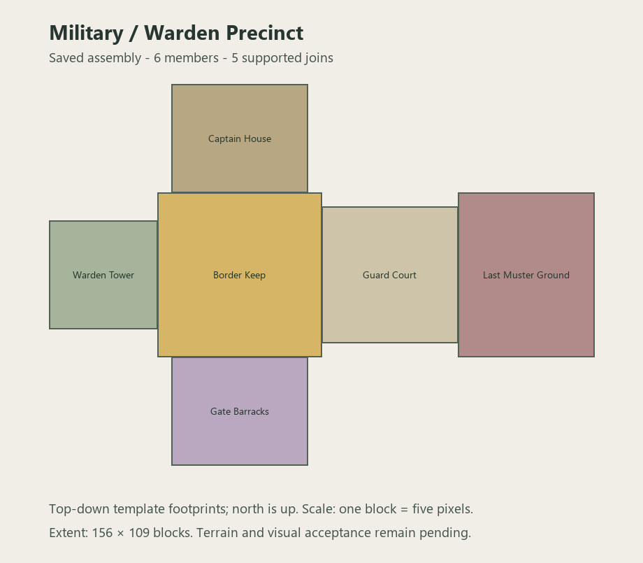

# Military / Warden precinct

Implements the six archetypes in Ancient Elven Structure Roster §6.7 as one connected assembly. The Border Keep anchors the Warden Tower, Watch Captain House, Gate Barracks and Discipline Yard / Guard Court; the court leads outward to the Last Muster Ground.

The history is a defense system becoming a final refuge. Barracks retain screening desks, reinforced doors and guards at their posts. The captain's house holds records, equipment racks and a defended upper landing. The tower has a supported stair to the surviving part of its broken signal platform. The keep has a patched breach, an inner retreat court and sealed supply magazines. The guard court has temporary detention bars, refugee bedding and a triage station. Roll-call stones and issue counters stand beside casualty beds and shallow burial trenches in the muster ground.

All six modules have eight blocks of authored foundation and explicit air throughout their occupied upper volume. There are no terrain-filled roof spaces or lamp carpets. Loot is limited to ordinary records and supplies. Powerful equipment is not provided through these caches.

The source generator writes 16 files: six templates, six pools, one assembly definition, one biome tag and two supply tables. Six members connect through five level, supported passages. A single family structure set can be enabled after field acceptance; none is enabled yet. This avoids scattering individual military buildings as unrelated natural structures.

Validation: source equality, registered materials, module bounds, non-overlap, joined walking routes, furnishings, beds, grave trenches and upper-platform access checks pass. Dedicated-server placement in `validation-military-warden-20261013` saved all six members and five supported joins, with 227,860 authored air cells and 71,536 foundation cells verified. Beds, remains, cultural modules, stairs, doors, bars, glass and roof ribs match source. Initial assembly console: `server/console-20261013-163114.log`. The repeatable harness records final evidence in `tools/military_warden_runtime.json`; client visual acceptance remains pending.

Review placement: `/execute in mythicbotany:alfheim run place structure alfheim:military_warden ~ ~ ~` in a disposable world. Existing player worlds are not modified by the validation tools.

Next roster family: Frontier / Wilderness stewardship (§6.12). The new Sacred and Military families still need visual acceptance and natural-frequency decisions; the bounded harbor policy remains unchanged.
