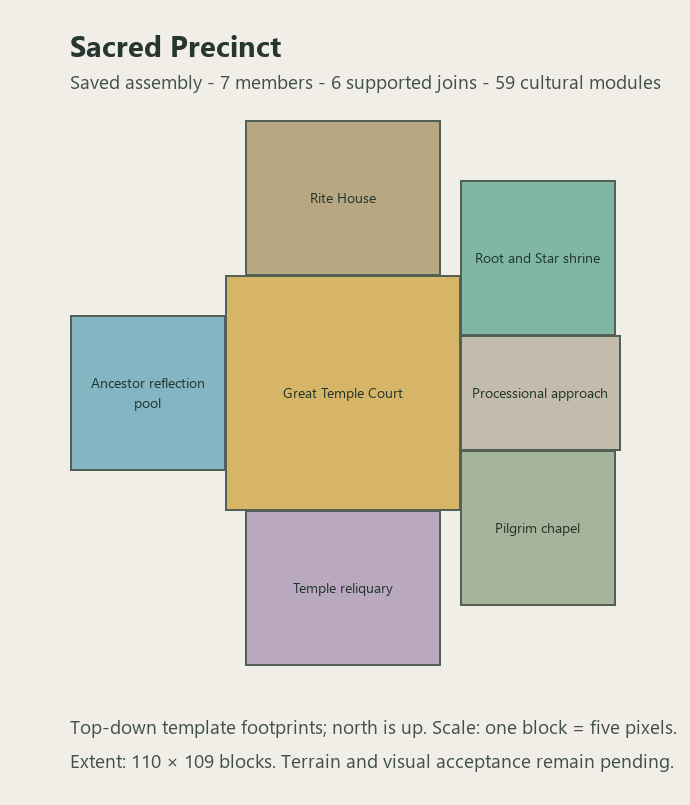

# Sacred Precinct prototype - 2026-10-13

Active Wave 3 family after the harbor decision. Seven connected sections cover
all six sacred-life archetypes in roster section 6.5 plus processional access:

| Section | Original purpose and decline |
|---|---|
| Great Temple Court | Ritual nave, broken roof ribs, shelter beds and improvised healer station |
| Shrine of Root and Star | Paired devotional steles, offering trace and refuge bedding |
| Ancestor Reflection Pool | Memorial basins, name-recording desk and later burial remains |
| Pilgrim Chapel | Travel bedding and a supported emergency canopy beneath a collapsed roof |
| Rite House | Funeral biers, overwhelmed registration desks and unfinished storage |
| Temple Treasury and Reliquary | Emptied outer stores and a sealed inner cabinet chamber |
| Processional Approach | Clear ceremonial walking axis and surviving framing |

The source uses eight-block foundations, explicit occupied/roof air, supported
furniture and banners, contained subfloor water and ordinary record/supply loot.
No new custom model or progression-relevant treasure is introduced.

Static checks pass for 18 source-equal resources, registered blocks, the 48-block
piece limit, seven non-overlapping members, six internal walking connections,
59 cultural modules, 288 contained water cells and 48 railing cells. The pool's
cache stands on dry ground. The shared topology reader preserves Civic Center
defaults; that family's regression check also passes.

Controlled live assembly now passes in a separate fresh test world. All seven
members, six supported doorways, 196,937 authored air cells and 65,968 foundation
cells were verified from the save. Beds, rails, reflection water, glazing, canopy
and cultural furnishings also match their source. Loose gravel is authored in its
settled position so it cannot migrate into intended room air after block updates.

Evidence: `tools/sacred_precinct_runtime.json`,
`tools/sacred_precinct_runtime_census.json` and
`server/console-20261013-154644.log`. Server and harness exited 0. A source
fingerprint ties this evidence to the tested resources. The test area now covers
all template rotations; an earlier smaller test area did not place the structure.

Client visual review and natural placement remain pending. No sacred natural
structure set is enabled. Harbor geometric perfection is not a prerequisite for
this family's further development. The next roster family is Military/Warden.

Sources: `tools/gen_sacred_precinct.py`, `tools/check_sacred_precinct.py` and
`tools/sacred_precinct_manifest.json`. Protected broad terrain remains unchanged.
